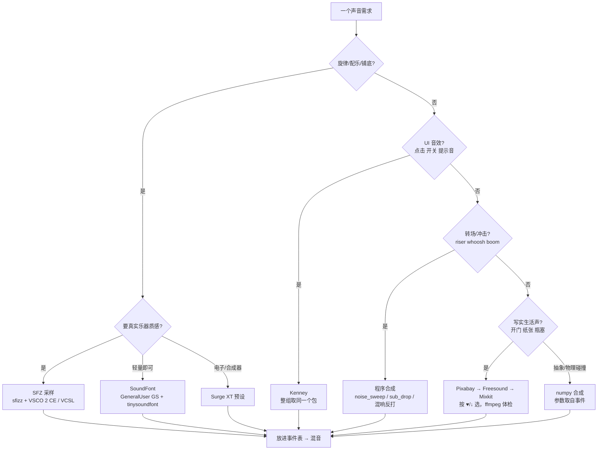
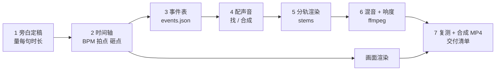

# AI 做视频的音效指南

归档日期：2026-10-30。
关键词：视频音效、配乐、混音、响度、LUFS、ffmpeg、Freesound、Pixabay、Kenney、Surge XT、sfizz、SoundFont、声画同步
变更记录：2026-10-30 新建（整合 sxhzju/sound 三个工具与 J 的视频项目做法，改为 Agent 可独立执行的版本）。

> **给 Agent：** 这份文档是做视频声音时的操作参考。按章节查，照命令执行。所需工具和获取方式都写在本节。
>
> | 前提 | 用途 |
> |---|---|
> | `ffmpeg` / `ffprobe` | 体检、混音、响度、合成 MP4（必需） |
> | `python3` | 辅助脚本、合成 |
> | `git` | 拉取辅助脚本 |
>
> 每个阶段都分 **首选**（辅助脚本）和 **备用**（不用脚本）两条路，脚本拉不下来或跑不起来时走备用。

### 准备工具（只做一次）

```sh
T=~/tools/sound                      # 或项目内 tools/sound
git clone --depth 1 https://github.com/sxhzju/sound "$T"

S="$T/sfx-sources/scripts/sfx.py"                 # 找音效：Pixabay / Freesound / Mixkit / Kenney
K="$T/procedural-audio/scripts/audio_kit.py"      # 合成：doctor / find / probe / sfzmap / check
export AK_DIR="$T/procedural-audio/scripts"       # Python 里 import audio_kit 用

python3 -m venv .venv && source .venv/bin/activate
python -m pip install -r "$T/procedural-audio/requirements.txt"
```

```
<tools_dir>/
├── sfx-sources/scripts/sfx.py              找音效、下载（只用标准库；Pixabay 首次会自建 curl_cffi venv）
├── sfx-sources/scripts/clash_freesound.py  ClashX Meta 代理检查（可选）
└── procedural-audio/
    ├── requirements.txt
    └── scripts/audio_kit.py + audio_backend.py   合成与分析
```

Python 脚本开头统一写：

```python
import os, sys; sys.path.insert(0, os.environ["AK_DIR"])
import audio_kit as ak          # ak.SR = 48000
```

后文所有命令都用 `$S`、`$K`、`AK_DIR`。

---

## 0. 一页速览

### 0.1 声音分四层

```
┌────────────────────────────────────────────────────┐
│ 旁白  人声，第一优先，其他层都给它让位             │
│ 配乐  情绪和节奏，说话时压低                       │
│ 音效  跟画面事件一一对应，时间准到采样             │
│ 环境  雨、风、房间底噪，电平最低，长淡入淡出       │
└────────────────────────────────────────────────────┘
          │ 每层单独成轨（stem），48 kHz 浮点 WAV
          ▼
  平衡音量/声像 → EQ → 压缩/让位 → amix 求和
  → 两遍 loudnorm（-16 LUFS-I，≤ -1 dBTP）→ 复测 → 合成 MP4
```

三条原则：

1. **一张时间表管所有声音。** 画面和声音读同一份事件表，任何一边都不写死时间。
2. **Agent 听不见，就用数字代替耳朵。** 选素材看 ♥/↓ 和评分人数，合成看 `probe`，混音看 LUFS、真峰值、逐拍响度和频谱图。
3. **每个声音能说清来源和许可证。** 合成的写"程序合成"，下载的记作者、链接、许可证。

### 0.2 哪个声音用哪种来源



| 来源 | 强项 | 弱项 | 什么时候用 |
|---|---|---|---|
| Pixabay | 库大，♥ 排序，免署名 | 有 Cloudflare，抓取可能 403 | 写实音效第一站 |
| Freesound | 真实拟音多，有上传者描述 | 只拿到约 190 kbps MP3 预览；许可证逐条不同 | Pixabay 没有合适的 |
| Mixkit | 精选 WAV | 只有文件名，没有评价信号 | 前两家都没有；给 2–3 个候选让人挑 |
| Kenney | 专做的 UI/游戏音效包，CC0 | 只有文件名 | 点击、开关、blip 首选 |
| Surge XT / sfizz | 真乐器、真合成器，可编程 | 要装插件和采样库 | 配乐、stinger、loop |
| SoundFont | 一个 `.sf2` 就能跑，依赖少 | GM 味重 | 快速出配乐、简单打击 |
| numpy 合成 | 参数和画面一一对应，可复现 | 写实声难做 | 抽象画面、物理碰撞、成百上千个变体 |

---

## 1. 环境准备

### 1.1 依赖清单

找音效和混音只要 python3、ffmpeg/ffprobe 和网络。纯 Python 合成和分析只要准备工具里的 venv；Surge 预设要 Surge XT，SFZ 乐器要 sfizz 加采样库，按需装。

| 组件 | 下载 | 版本 / 注意 |
|---|---|---|
| Surge XT | https://surge-synthesizer.github.io/downloads/ | 装 **VST3**；适配器按 1.3.4 验证 |
| sfizz | https://sfz.tools/sfizz/downloads/ | 装 **VST3**；适配器按 1.2.3 验证 |
| VSCO 2 CE | https://versilian-studios.com/vsco-community/ | 选 **Vanilla SFZ Version / Direct Download** |
| VCSL | https://versilian-studios.com/vcsl/ | 下载 SFZ 和完整样本 |
| pedalboard | `requirements.txt` 固定 `pedalboard==0.9.26` | 状态适配器按这个版本验证 |

只装 standalone、AU 或 CLAP 版不能用。Python 和插件的 CPU 架构要一致。采样库要完整解压，保留 `.sfz`、WAV 和相对目录；只拷 `.sfz` 不出声。

### 1.2 Python 依赖

已在"准备工具"里装好。没有对应二进制包时，换 Python 3.11 或 3.12 重建环境。之后所有命令都用这个 venv 的 `python`。

### 1.3 环境变量（启动 Python 之前设置）

```sh
export SOUND_SURGE_PLUGIN="/path/to/Surge XT.vst3"          # 填具体 .vst3，填父目录无效
export SOUND_SURGE_DATA="/path/to/Surge XT factory data"    # 含 .fxp 的目录，递归搜索
export SOUND_SFIZZ_PLUGIN="/path/to/sfizz.vst3"
export SOUND_SAMPLE_DIR="/path/to/audio-assets"             # 采样库根目录，递归找 .sfz
```

不设时会尝试系统常见安装位置；`SOUND_SAMPLE_DIR` 默认是当前项目下的 `audio-assets/`。PowerShell 写法：`$env:SOUND_SAMPLE_DIR = "D:\Audio\Libraries"`。

### 1.4 自检

```sh
python "$K" doctor                       # 缺的资源显示 MISSING
python "$K" find "kick" --kind surge     # 打印可直接 load() 的名字
python "$K" find "harp" --kind sfz
python "$K" probe "Category/Actual Preset Name" 60
python "$K" sfzmap "/absolute/path/to/Actual Instrument.sfz"
```

`probe` 报"不支持的状态格式"时，换成 1.1 表里的版本，不要忽略报错。

---

## 2. 七步工作流



旁白一改，时间轴和所有声音都要重算，所以旁白最先定稿。

事件表字段：

```jsonc
{
  "t": 5.10,          // 发声时刻（秒）
  "kind": "knock",    // 事件类型 → 决定用哪个声音函数/素材
  "obj": "door",
  "mat": "wood",      // 材质 → 音色
  "strength": 0.8,    // 力度 0~1 → 增益
  "pan": -0.2,        // 画面横向位置 → 声像
  "depth": 1.0,       // 离镜头距离 → 轻微衰减
  "source": "synth"   // synth | sfz | sf2 | px:<id> | fs:<id> | mk:<id> | kn:<pack>/<file>
}
```

`source` 用 `sfx.py` 的 key 格式，交付时可以直接据此生成署名清单。

---

## 3. 找现成音效

### 3.1 首选：`sfx.py`

```sh
python3 "$S" pixabay "<英文查询>"            # ♥likes ↓downloads，跨 3 页按 ♥ 排
python3 "$S" freesound "<英文查询>"          # ↓downloads ★rating(votes) 许可证 描述
python3 "$S" freesound "cork pop" --license cc0     # 只要 CC0
python3 "$S" freesound "paper slide" --license by   # CC0 + CC BY
python3 "$S" mixkit <tag>                    # 一个英文单词，如 whoosh
python3 "$S" kenney                          # 列出所有音效包
python3 "$S" kenney <pack>                   # 下载并列出包内文件
python3 "$S" get sfx/ px:123 fs:456 mk:789 kn:<pack>/<file>   # 一次传全部 key，6 线程并行
```

| 参数 | 适用 | 作用 |
|---|---|---|
| `--urls` | pixabay / freesound / mixkit | 附试听链接 |
| `-n N` | 同上 | 返回条数（默认 pixabay/freesound 8，mixkit 10） |
| `--pages K` | pixabay / freesound | 取几页相关结果再本地重排（默认 3） |
| `-p PAGE` | pixabay / freesound | 起始页 |
| `--license cc0\|by\|any` | freesound | 许可证过滤 |
| `--sort relevance\|downloads\|rating\|short` | freesound | 默认 relevance，再按下载量重排 |

规则：**先搜再下。** `get` 依赖 `~/.cache/sfx-sources/index.json` 里的搜索结果；Kenney 要先跑 `kenney <pack>`。下载的文件名形如 `fs_<id>_<标题>.mp3`，非 CC0 的 Freesound 文件会打印 `credit <作者>`。

### 3.1b 备用：直接用网页

脚本跑不起来时，打开搜索页读同样的信号，手动或用网页抓取下载：

| 来源 | 搜索页 | 读什么 | 下载 |
|---|---|---|---|
| Pixabay | `https://pixabay.com/sound-effects/search/<query>/` | 卡片 ♥；详情页的 ♥、↓、时长 | 详情页的 Download |
| Freesound | `https://freesound.org/search/?q=<query>` | ↓、★ 和评分人数、许可证、上传者描述 | 详情页预览 MP3；原始文件需登录 |
| Mixkit | `https://mixkit.co/free-sound-effects/discover/<tag>/` | 只有标题和时长 | 卡片的 Download（WAV） |
| Kenney | `https://kenney.nl/assets/category:Audio` | 包名 | 包页面的 zip，解压取文件 |

记下每个文件的页面链接、作者、许可证，填进事件表 `source`。

### 3.2 选源顺序

```
写实音效：Pixabay ──没有──▶ Freesound ──没有──▶ Mixkit
UI 音效 ：Kenney（同一段 UI 动作全部取自同一个包，听起来是一套）
```

专做的 UI 点击声比评分很高的真实开关声更合适。

### 3.3 怎么读信号

| 信号 | 规则 |
|---|---|
| ♥ / ↓ | 在符合画面的候选里选最高的，提案时报出数字 |
| 评分人数 | 人数比平均分重要：★4.4(380) 比 ★4.9(6) 可信 |
| Freesound 描述 | 最接近试听。"built-in mic""made with my mouth" = 低保真；写明录音机（Zoom、Sound Devices）和明确声源（"cork from a wine bottle"）= 可预期。声源和画面不符直接淘汰 |
| 时长 | 热度不代表合适：♥3k 的 "thud" 可能是 3 秒电影轰鸣。先看时长 |
| 只有文件名（Mixkit、Kenney） | 信号弱，给 2–3 个候选加 `--urls` 让人挑 |

### 3.4 下载后 ffmpeg 体检

```sh
f=fs_123_door-knock.mp3
ffprobe -v error -show_entries format=duration:stream=sample_rate,channels -of default=nw=1 "$f"
ffmpeg -hide_banner -i "$f" -af silencedetect=noise=-45dB:d=0.05 -f null - 2>&1 | grep silence  # 前导静音、尾巴结束点
ffmpeg -hide_banner -i "$f" -af astats -f null - 2>&1 | grep -Ei "peak level|rms level"     # 整段峰值、RMS
ffmpeg -hide_banner -i "$f" -lavfi showspectrumpic=s=800x300 "${f%.*}_spec.png"                # 能量在高频还是低频
```

`-45dB` 是经验阈值，按素材调。前导静音先切掉，起音点才能对准事件时刻：

```sh
ffmpeg -i "$f" -af "silenceremove=start_periods=1:start_threshold=-45dB" -c:a pcm_f32le -ar 48000 trimmed.wav
```

### 3.5 网络问题

| 现象 | 处理 |
|---|---|
| Freesound 超时 | `python3 "$T/sfx-sources/scripts/clash_freesound.py"`（只看状态）；`--fix` 会**改本机 ClashX Meta 配置并切节点**，只在 ClashX Meta（控制器 127.0.0.1:9090）环境用 |
| Freesound 很慢 | 单连接约 80 KB/s，把所有 key 放进同一条 `get` 并行下 |
| Pixabay 返回 403 | Cloudflare 收紧了；改用网页搜索拿标题，或换 Freesound |

---

## 4. 合成音乐和音效

### 4.1 首选：`audio_kit.py` 挑音色、验音色

```sh
python "$K" find "kick" --kind surge          # 输出 "Drums/T8 Kick 1" 这类 spec
python "$K" find "harp" --kind sfz            # 输出 "VSCO-2-CE-1.1.0/Harp.sfz" 这类 spec
python "$K" probe "Pads/Film" 57 69           # 每个音：起音、衰减、早/晚段频谱峰（MIDI 号）
python "$K" probe "Pads/Film" 57 --length 4   # pad 类用更长的音看漂移
python "$K" sfzmap "Mark Trees.sfz"           # 哪个键/力度触发哪个样本
python "$K" check out.wav --bpm 140 --png /tmp/x.png   # 峰值、LUFS、削波数、L/R 相关、逐拍响度、频谱图；输入须 48 kHz
```

spec 写法：Surge 用 `"Category/Name"`，SFZ 用以 `.sfz` 结尾的名字或绝对路径。

### 4.2 Python API 速查

```python
import os, sys; sys.path.insert(0, os.environ["AK_DIR"])
import audio_kit as ak          # ak.SR = 48000
```

| 函数 | 作用 | 要点 |
|---|---|---|
| `ak.load(spec)` | 载入 Surge 预设或 SFZ 乐器 | Surge 写 `"Category/Name"`，SFZ 写以 `.sfz` 结尾的名字或路径 |
| `ak.render(plugin, [(midi, start_s, len_s, vel)], tail=2.0)` | 渲染成 `(2, n)` 数组 | **峰值归一化**，电平只由 `place` 决定 |
| `ak.timeline(seconds)` | 空时间轴 | |
| `ak.place(mix, audio, at, gain_db)` | 把声音放到 `at` 秒 | `at` 可为负 |
| `ak.reverse(audio)` | 反打 | 先修掉两端静音，结尾正好落在放置点 |
| `ak.fade(audio, fade_in, fade_out)` | 淡入淡出 | |
| `ak.trim(audio)` | 去两端静音 | |
| `ak.noise_sweep(dur, f0, f1, seed=0)` | 带通噪声扫频 | f1>f0 = riser，f1<f0 = 下落 whoosh |
| `ak.sub_drop(seconds=1.3, f0=73.42, f1=36.71)` | 下滑正弦轰鸣 | 冲击的低频 |
| `ak.kweighted_db(audio, start, end)` | 一段的 K 加权响度 | 比较段落用它，别用 RMS |
| `ak.master(mix)` | 限幅器固定推 2 dB，峰值到 -1 dBFS | 最后一步用 |
| `ak.write(path, audio)` | 写 48 kHz / 24-bit WAV | |

### 4.3 模板：冲击 stinger（砸点 1.5 s）

```python
import os, sys; sys.path.insert(0, os.environ["AK_DIR"])
import audio_kit as ak

HIT = 1.5
mix = ak.timeline(HIT + 2.0)
cym = ak.load("Suspended Cymbal 1.sfz")                        # 键 68 = 敲击（见 sfzmap）
rev = ak.reverse(ak.render(cym, [(68, 0, 1.0, 110)]))[:, -int(1.2 * ak.SR):]
ak.place(mix, ak.fade(rev, fade_in=0.4), HIT - rev.shape[1] / ak.SR, -8)   # 反打镲，结尾对准砸点
ak.place(mix, ak.noise_sweep(HIT, 300, 8000), 0, -10)                     # riser
ak.place(mix, ak.render(ak.load("Drums/T8 Kick 1"), [(45, 0, 0.2, 127)]), HIT, -3)
ak.place(mix, ak.render(cym, [(68, 0, 1.0, 127)]), HIT, -4)
ak.place(mix, ak.sub_drop(), HIT, -3)
ak.write("impact.wav", ak.master(ak.fade(mix, fade_out=0.6)))
```

### 4.4 配乐工作流

```
1 网格   BPM、调性、逐小节角色、同步点；时间用拍 B = 60/BPM
2 选音   find → 每个有音高的音色都 probe；VCSL 打击乐先看 sfzmap
3 分轨   每个声部一条 stem，place 到时间轴；相关声部走同一个 pedalboard 总线
         （鼓偏干，音乐加混响/延迟）
4 动态   过渡段：律动低几 dB → 渐强 → 砸点前留约一个八分音符的空 → 砸点最响 → 尾巴
5 验证   check --bpm --png：逐拍响度要"渐强、空处下凹、砸点最高"；再看频谱图
6 交付   48 kHz / 24-bit WAV + 生成脚本；写明同步点（例如"砸点在 3.43 s"）
```

共享混响总线示例：

```python
from pedalboard import Pedalboard, Reverb
bus = Pedalboard([Reverb(room_size=0.4, wet_level=0.2)])
music = bus(music_stem, ak.SR)            # (2, n) float32
```

### 4.5 probe 结果怎么看

健康的有音高音色：峰值是弹的音加谐波（+12、+19、+24），早段和晚段一致。

| 问题 | 表现 | 例子 | 处理 |
|---|---|---|---|
| 漂移 | 早晚峰值不同 | Pads/Galaxy Pad | 别用来弹和弦 |
| 自带和弦/音程 | 有无关的强音高 | Chords/6 Osc Stab 一键一和弦；Pads/Film 叠了五度（+7） | 配和声时算进去 |
| 八度偏移 | 峰值整体偏 ±12/24 | VSCO Glockenspiel +12；Plucks/Techno Stab 约 -24；Basses/Rounded、Useful、Warm Square -12 | 移调补偿 |
| 鼓跟音高 | 鼓也有音高 | Drums/T8 Kick 1 音 45 = A1（55 Hz） | 按调选音 |

写音符前用 `sfzmap` 确认 SFZ 的键位范围。

### 4.6 备用：SoundFont + tinysoundfont

拉不到脚本或不装插件时，`pip install tinysoundfont numpy`，用一个 `.sf2`（例如 GeneralUser GS）编曲。tinysoundfont 0.3.7 的预编译包只到 Python 3.12，3.13 上会编译失败，用 3.12 的 venv：

```python
import numpy as np, tinysoundfont as tsf
SR = 48000
syn = tsf.Synth(samplerate=SR)
sfid = syn.sfload(open("GeneralUser-GS.sf2", "rb").read())
syn.program_select(0, sfid, 0, 73, False)       # bank 0, GM 73 长笛；鼓组用 bank=128 并设 True

def render(events, n):                          # events: [(t, kind, a, b)]
    out, pos = np.zeros((n, 2), np.float32), 0
    for t, kind, a, b in sorted(events):
        s = min(n, int(t * SR))
        if s > pos:
            out[pos:s] = np.frombuffer(syn.generate_simple(s - pos), np.float32).reshape(-1, 2)
            pos = s
        if kind == "on":  syn.noteon(0, a, b)
        if kind == "off": syn.noteoff(0, a)
    if pos < n:
        out[pos:] = np.frombuffer(syn.generate_simple(n - pos), np.float32).reshape(-1, 2)
    return out
```

可用的控制：`control_change`（如 CC11 做渐强）、`pitchbend`、`pitchbend_range`（长号滑音这类效果）。鼓组的单音（如 36 号底鼓）加定音鼓也能兼做简单冲击音效。

### 4.7 备用：numpy 合成（参数取自事件）

| 画面属性 | 声音参数 |
|---|---|
| 材质 | 模态频率比和衰减，如木琴 `[1.0, 3.93, 9.24]` |
| 物体尺寸 / 设计音符 | 音高 |
| 撞击强度 \|Δv\| | 力度：按同类事件中位数归一，限制在 0.35–1.4 |
| 横向位置 | 声像 pan |
| 离镜头距离 | 轻微衰减 |

一个事件类型写一个函数（`knock()`、`wind()`、`splash()`），参数全部来自事件表。whoosh/riser 用带通噪声扫频，boom 用下滑正弦加指数衰减，响度用 `pyloudnorm` 测。所有随机数固定种子（`np.random.default_rng(20261024)`、`random.Random(7)`），同样输入跑两次输出一致。

---

## 5. 混音与响度（只用 ffmpeg）

### 5.1 八步

```
1 检查    ffprobe 时长/声道/采样率；ebur128=peak=true 测 LUFS/真峰值；统一采样率和声道
2 平衡    先 volume 和 pan；留约 6 dB 余量；不要逐轨单独归一化
3 EQ      在整体里调：highpass 去隆隆（别切到基频）；先切后提，每次 1–3 dB
          查 200–500 Hz 浑、2–5 kHz 刺、5–9 kHz 齿音；不盲切
4 动态    只压真正不均的轨（acompressor 从 2:1 起，保留瞬态）；
          旁白下压配乐用 sidechaincompress；剪辑处加淡变，保留尾巴
5 求和    amix=inputs=N:normalize=0，显式增益；明确选 duration；查总线峰值
6 响度    默认整片 -16 LUFS-I、≤ -1 dBTP（有平台规格按规格）；两遍 loudnorm，优先 linear
7 对比    同响度下对比；查转场、安静段、响段和单声道兼容
8 导出    默认 48 kHz / 24-bit WAV；对解码后的交付文件复测响度、真峰值、时长、声道
```

本章只用 ffmpeg，没有备用路线的需要。中间文件一律用浮点 WAV（`-c:a pcm_f32le`），原始素材不覆盖。

### 5.2 命令

**检查**

```sh
ffprobe -v error -show_entries stream=sample_rate,channels:format=duration -of default=nw=1 vo.wav
ffmpeg -hide_banner -nostats -i vo.wav -af ebur128=peak=true -f null - 2>&1 | grep -A 13 Summary   # I、LRA、True peak
```

**把音效放到事件时刻 + 声像 + 增益**

```sh
# 5.10 s 处，-6 dB，略偏左
ffmpeg -i knock.wav -af "adelay=5100|5100,volume=-6dB,stereotools=balance_out=-0.2" -ar 48000 -c:a pcm_f32le knock_placed.wav
```

**EQ 和压缩（旁白）**

```sh
ffmpeg -i vo.wav -af "highpass=f=80,equalizer=f=300:t=q:w=1:g=-2,acompressor=threshold=-18dB:ratio=2:attack=10:release=200" -c:a pcm_f32le vo_eq.wav
```

**旁白下压配乐（ducking）+ 求和**

```sh
ffmpeg -i music.wav -i vo_eq.wav -i sfx.wav -filter_complex "\
[1:a]asplit=2[vo][k0];[k0]apad[key];\
[0:a]highpass=f=30,volume=-4dB[m];\
[m][key]sidechaincompress=threshold=0.05:ratio=8:attack=20:release=400[mduck];\
[mduck][vo][2:a]amix=inputs=3:normalize=0:duration=longest[out]" \
-map "[out]" -ar 48000 -c:a pcm_f32le mix_pre.wav
```

`threshold/ratio/attack/release` 是起点，按测量调：说话段旁白至少比配乐高约 10 LU。`apad` 让旁白键控信号补齐到配乐长度；不加时 sidechaincompress 在旁白结束处就停，后面的配乐会被截掉。

**两遍 loudnorm**

```sh
# 第 1 遍：只测
ffmpeg -hide_banner -i mix_pre.wav -af loudnorm=I=-16:TP=-1:LRA=11:print_format=json -f null -
# 第 2 遍：填入 input_i / input_tp / input_lra / input_thresh / target_offset，目标值和第 1 遍完全相同
ffmpeg -i mix_pre.wav -af "loudnorm=I=-16:TP=-1:LRA=11:measured_I=<input_i>:measured_TP=<input_tp>:measured_LRA=<input_lra>:measured_thresh=<input_thresh>:offset=<target_offset>:linear=true:print_format=summary" \
  -ar 48000 -c:a pcm_s24le mix_final.wav
```

第 2 遍输出里看 `Normalization Type`：显示 `Dynamic` 说明 linear 没生效（常见原因是素材 LRA 超过目标 LRA，或真峰值放不下）。这时调高 `LRA` 目标或先降峰值再跑。ffmpeg 的默认目标是 I=-24、TP=-2、LRA=7，**必须显式写**。`-ar 48000` 也必须写，loudnorm 内部会上采样。

**复测交付文件 + 单声道检查**

```sh
ffmpeg -hide_banner -nostats -i mix_final.wav -af ebur128=peak=true -f null - 2>&1 | grep -A 13 Summary
ffmpeg -hide_banner -nostats -i mix_final.wav -af "pan=mono|c0=0.5*c0+0.5*c1,ebur128" -f null - 2>&1 | grep -A 6 Summary
```

### 5.3 让位（ducking）三档

| 档 | 做法 | 参数 |
|---|---|---|
| 简单 | 有旁白时配乐乘固定系数 | ×0.38（约 -8.4 dB）；话前 0.25 s 开始压、话后 0.45 s 回升、0.2 s 平滑 |
| 平滑 | 固定系数 + 包络 | ×0.42（约 -7.5 dB）；起 0.12 s、收 0.9 s；情绪最低段配乐再退 |
| 精确 | 逐句按响度差计算 | 每句旁白比配乐高 ≥ 10 LU，迭代求压低量，最多 20 dB；说话时中频再让 4 dB、高频再让 2 dB；两句间隔 < 0.9 s 不回升；砸点贴着话头时先放过 0.10 s |

### 5.4 响度目标

| 场景 | 整体响度 | 真峰值 |
|---|---|---|
| 默认 / 网络视频 | -16 LUFS-I | ≤ -1 dBTP |
| 想更响的网络视频 | -14 LUFS-I | ≤ -1 dBTP |
| 视频铺底、stinger 单独交付 | -16 到 -14 LUFS | 峰值 -1 dBFS |
| 广播（EBU R128） | -23 LUFS | ≤ -1 dBTP |
| 短音效 | 按峰值和上下文判断，不看 LUFS | |
| 要压成 AAC | 目标不变 | 留到 -1.5 到 -2 dBTP 更稳 |

---

## 6. 声画同步

| 要点 | 做法 |
|---|---|
| 单一时间源 | 画面和声音读同一份时间表/事件表 |
| 用实际时刻 | 物理模拟、动画曲线导出的时刻优于设计值（从烘焙后的动画提取碰撞） |
| 时间写成拍 | `B = 60 / BPM`，砸点、转场吸附到拍点或小节线 |
| 帧和采样 | 30 fps 一帧 33.3 ms，24 fps 41.7 ms；音频按采样定位，可落在帧之间 |
| 起音对齐 | 素材先切前导静音，起音点对准事件时刻 |
| 留白 | 砸点前停约一个八分音符，比加音效更有力 |
| 人性化 | 音符时间 ±6 ms、力度 ±5 随机（固定种子） |
| 不加音效 | 也是选项：提示交给画面，只留旁白和配乐 |
| 不要用自带节奏的预设 | Sequences、Rhythms、Arps 预设有内置节奏，要锁 BPM 时自己写音符 |

合成视频：

```sh
ffmpeg -framerate 30 -i frames/f%05d.png -i mix_final.wav \
  -map 0:v -map 1:a -c:v libx264 -crf 16 -pix_fmt yuv420p -c:a aac -b:a 256k -shortest out.mp4
```

分章节时，每章音频用 `apad,atrim=duration=<秒>` 补齐或截断到本章时长；没有配乐的章用 `anullsrc=r=48000:cl=stereo` 补静音；每章配乐最后约 1 秒淡出。

---

## 7. 许可证速查

| 来源 | 商用 | 署名 | 要注意 |
|---|---|---|---|
| 程序合成 | 可以 | 不需要 | 写明"声音全部程序合成" |
| CC0（Freesound CC0） | 可以 | 不需要 | 建议仍记录链接 |
| CC BY（Freesound Attribution） | 可以 | **必须**：作者、作品名、链接、许可证 | `sfx.py get` 会打印 `credit <作者>` |
| CC BY-NC | **不可以** | 必须 | 商用项目直接排除；`--license cc0\|by` 过滤掉 |
| Pixabay | 可以 | 不需要 | 不能原样单独售卖或分发；含可识别商标的内容不能用于商品/服务的商业用途 |
| Mixkit 音效 | 可以 | 不需要 | 不能单独再分发、做成素材包或模板；不能登记到版权管理系统（如 Content ID） |
| Kenney | 可以（CC0） | 不需要 | 不要用 Kenney 的 logo |
| VSCO 2 CE | 可以（CC0） | 不需要 | |
| VCSL | 可以（CC0） | 不需要 | |
| GeneralUser GS | 可以，个人和商业音乐都行，可修改、可随软件打包 | 不需要 | 介绍它时不要直链作者的下载文件，链到作者网站或自带副本 |

交付时生成一份署名清单：从事件表的 `source` 字段汇总非合成声音的作者、链接、许可证。

---

## 8. 交付前检查清单

**素材**
- [ ] 事件表每个事件都有声音，或明确标"不发声"。
- [ ] 下载素材的声源和画面一致；时长、尾巴测过；前导静音切掉了。
- [ ] 每个非合成素材都有作者、链接、许可证；商用项目里没有 BY-NC。
- [ ] 每个有音高的 Surge/SFZ 音色都 `probe` 过；VCSL 打击乐看过 `sfzmap`。

**同步**
- [ ] 抽查 5 个关键事件：音效起音和画面接触在同一帧或相邻帧。
- [ ] 砸点是全片该段最响的一刻（`check --bpm` 逐拍响度确认）。
- [ ] 旁白没被转场或砸点切断。

**混音**
- [ ] 每条 stem 单独测过电平；求和用 `normalize=0`；总线不过载。
- [ ] 说话段旁白比配乐高约 10 LU，或确认每个字都清楚。
- [ ] 200–500 Hz 不浑，2–5 kHz 不刺，混响尾巴没有嘶嘶声（看频谱图 4–16 kHz）。
- [ ] 开头没爆音，结尾有淡出，单声道下不缺东西。

**响度**
- [ ] 两遍 loudnorm，`Normalization Type` 是 linear。
- [ ] 复测交付文件：-16 LUFS-I（或平台规格），真峰值 ≤ -1 dBTP，时长、声道、采样率正确。
- [ ] 测量值写进报告（如 `mix_report.json`）。

**可复现**
- [ ] 随机种子固定；同样输入跑两次结果一致（部分 Surge 预设有随机性，允许 1–2 dB 差异）。
- [ ] 交付 48 kHz / 24-bit WAV + 生成脚本，一条命令能重跑。

---

## 9. 常见坑

| 坑 | 后果 | 处理 |
|---|---|---|
| Surge 在 t=0 起音 | 静音 | 用 `ak.render`（自动加 0.5 s 引子再裁掉）；直接调 `audio_backend.render_notes` 要自己偏移 |
| `render_notes` 的副作用 | 总会写 WAV，峰值超 0.95 时悄悄衰减 | 不靠它的电平对齐各 stem |
| 预设名跨类别重复 | 载错音色 | 一律 `"Category/Name"`，从 `find` 输出复制 |
| VCSL 打击乐按键分演奏法 | "镲"弹出来是滚奏 | 先 `sfzmap`：Suspended Cymbal 1 是 60–63 弓擦、64–67 渐强滚奏、68 敲击、69 镲心；Mark Trees 60 上行、61 下行、62 快速上行 |
| 用 RMS 比段落响度 | 被低频底鼓主导 | 用 `check` / `ak.kweighted_db` |
| 求和后猛压限幅器 | 砸点被压平 | 用 `ak.master`（固定推 2 dB） |
| Freesound 文件 | 只是约 190 kbps MP3 预览 | 正式作品要原始 WAV 需自己申请 Freesound API |
| `clash_freesound.py --fix` | 改本机代理配置并切节点 | 只在 ClashX Meta 环境用；先跑不带参数的状态检查 |
| 白噪声混响 | 尾巴嘶嘶 | 用模态混响或卷积混响，测尾巴 4–16 kHz 能量 |
| 测 AAC 之后的峰值才发现超标 | 返工 | 在编码前的母带上测，真峰值留到 -1.5 dBTP 以下更稳 |

---

## 10. 给 Agent 的规则摘要

使用本文档时遵守下面的规则。可以原样粘进项目的 CLAUDE.md 或 AGENTS.md。

```markdown
## 视频声音规则

### 工具
- 先按声音指南的"准备工具"clone 辅助脚本并设好 $S、$K、AK_DIR；失败时走各章的备用路线，并告诉我用了备用。

### 结构
- 声音分四轨：旁白 / 配乐 / 音效 / 环境，各自导出 48 kHz 浮点 WAV stem 到 audio/stems/。
- 画面和声音共用一个时间源：所有发声时刻写进 audio/events.json
  （t, kind, obj, mat, strength, pan, depth, source），声音脚本里不写死时间。
- 时刻取画面实际发生的时刻；配乐时间写成拍（B = 60 / BPM）。旁白先定稿再排时间轴。

### 选声音
- UI 音效先用 Kenney，同一段动作取同一个包。
- 写实音效顺序：Pixabay → Freesound → Mixkit（首选 $S，备用网页）。按 ♥/↓ 和评分人数选（人数比平均分重要），
  向我报出数字并附 --urls 试听链接；描述里声源不符的直接淘汰。只有文件名的来源给 2–3 个候选。
- 下载后用 ffprobe/ffmpeg 量时长、前导静音、尾巴和频谱，切掉前导静音再用。
- 商用项目只用 CC0、CC BY、Pixabay、Mixkit、Kenney；排除 CC BY-NC。
- 转场和冲击用 audio_kit：noise_sweep、sub_drop、ak.reverse（备用 numpy）。配乐用 Surge XT / sfizz，
  或 GeneralUser GS + tinysoundfont。
- 每个有音高的音色先 audio_kit.py probe；VCSL 打击乐先 sfzmap；载入一律用 "Category/Name"。
- 不运行 clash_freesound.py --fix，除非我同意。

### 混音
- 只用 ffmpeg：先 volume/pan，留 6 dB 余量；EQ 每次 1–3 dB，先切后提；压缩从 2:1 起。
- 旁白下压配乐（sidechaincompress），说话段旁白比配乐高约 10 LU。
- 求和用 amix=inputs=N:normalize=0；不逐轨归一化；不在求和后猛压限幅器。
- 成片 -16 LUFS-I、≤ -1 dBTP（有平台规格按规格），两遍 loudnorm，确认是 linear。
- 导出 48 kHz / 24-bit WAV，对交付文件复测 I、TP、时长、声道，写入 audio/mix/mix_report.json。
- 合成部分用 audio_kit.py check --bpm --png 确认逐拍响度符合计划（渐强、留空、砸点最响），并查看频谱图。

### 交付
- 随机数固定种子；交付 WAV + 生成脚本，并写明同步点（如"砸点在 3.43 s"）。
- 生成署名清单：非合成声音写作者、链接、许可证；合成的写"程序合成"。
- 你无法试听，交付时明确说明"只做了仪表测量，未试听"。
```

---

## 【说人话】

先 clone 一次辅助脚本，这份文档就能直接用；脚本不行也有纯网页、纯 numpy、纯 ffmpeg 的备用路线。

做视频的声音，先列一张"第几秒发生了什么"的清单，画面和声音都照这张清单走。然后给每件事配声音：

- 按钮、提示音去 Kenney 拿，一套用到底；
- 生活里的真实声音按 Pixabay → Freesound → Mixkit 的顺序找，看点赞数、下载数和评分人数，下载后用 ffmpeg 量一下长短和尾巴；
- 转场的"嗖"、砸点的"轰"用 `audio_kit` 几行代码合成，没有脚本就用 numpy 写；
- 配乐用 Surge XT、sfizz 加免费采样库弹出来，图省事就用 GeneralUser GS 这一个音色文件。

最后用 ffmpeg 混音：说话时音乐让开，所有轨求和时不自动降音量，整片两遍归一到 -16 LUFS、真峰值不超过 -1 dB，导出 48 kHz / 24-bit 后再量一次。记好每个声音的出处，BY-NC 的别进商用片。

---

## 参考链接

**辅助脚本和方法**
- [sxhzju/sound](https://github.com/sxhzju/sound)：[sfx-sources](https://github.com/sxhzju/sound/tree/main/sfx-sources) · [procedural-audio](https://github.com/sxhzju/sound/tree/main/procedural-audio) · [audio-mixing](https://github.com/sxhzju/sound/tree/main/audio-mixing)
- [vibe-motion/sound](https://github.com/vibe-motion/sound)

**乐器和音色库下载**
- [Surge XT](https://surge-synthesizer.github.io/downloads/)
- [sfizz](https://sfz.tools/sfizz/downloads/)
- [VSCO 2 CE](https://versilian-studios.com/vsco-community/)
- [VCSL](https://versilian-studios.com/vcsl/)
- [GeneralUser GS](https://schristiancollins.com/generaluser.php)

**许可证**
- [Freesound FAQ（Licenses 一节）](https://freesound.org/help/faq/#licenses)
- [CC0 1.0](https://creativecommons.org/publicdomain/zero/1.0/) · [CC BY 4.0](https://creativecommons.org/licenses/by/4.0/)
- [Pixabay Content License 摘要](https://pixabay.com/service/license-summary/)
- [Mixkit License](https://mixkit.co/license/)（Sound Effects Free License）
- [Kenney 使用说明](https://kenney.nl/support)

**工具文档**
- ffmpeg 滤镜：[loudnorm](https://ffmpeg.org/ffmpeg-filters.html#loudnorm) · [ebur128](https://ffmpeg.org/ffmpeg-filters.html#ebur128-1) · [sidechaincompress](https://ffmpeg.org/ffmpeg-filters.html#sidechaincompress) · [amix](https://ffmpeg.org/ffmpeg-filters.html#amix)
- [pedalboard](https://github.com/spotify/pedalboard)
- [tinysoundfont（PyPI）](https://pypi.org/project/tinysoundfont/)
